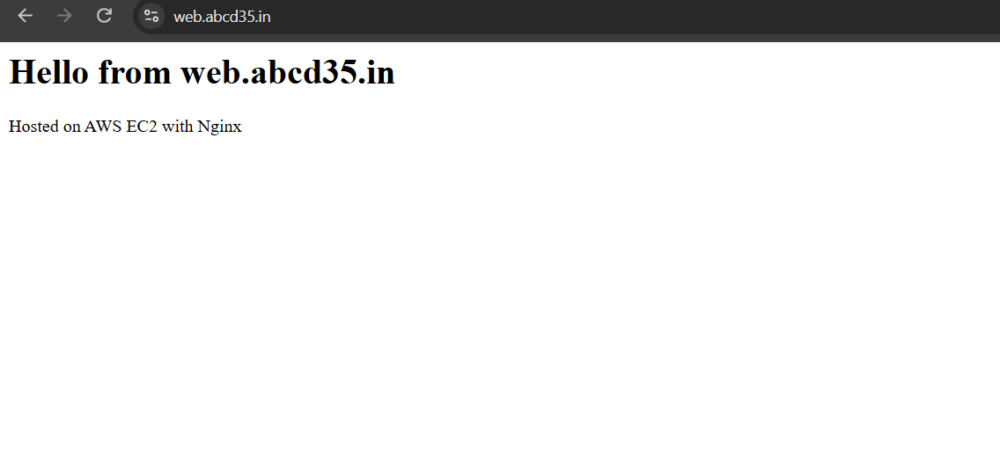
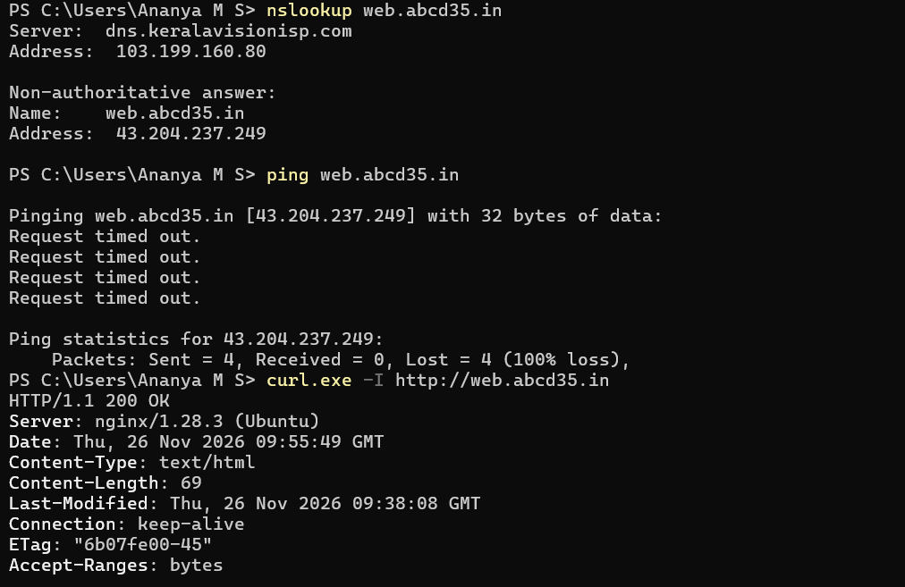
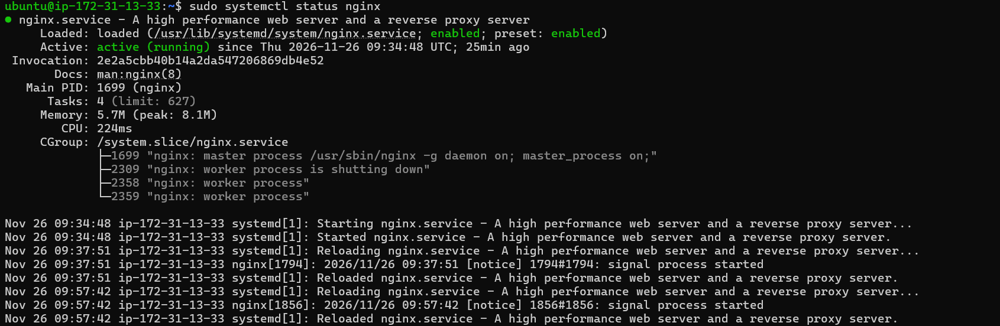
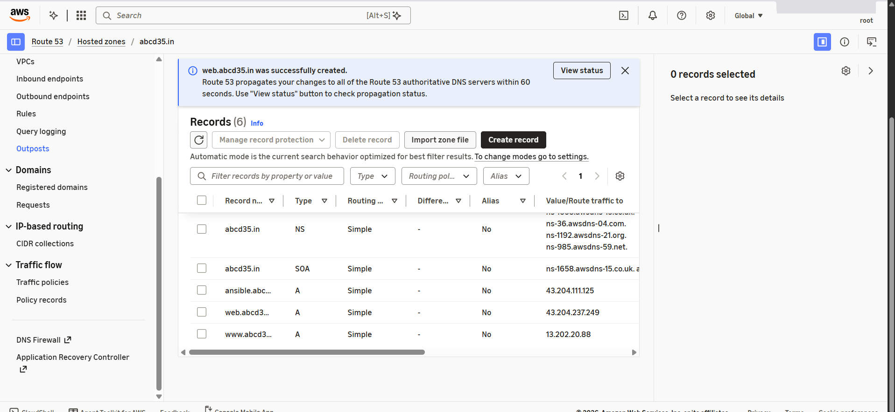
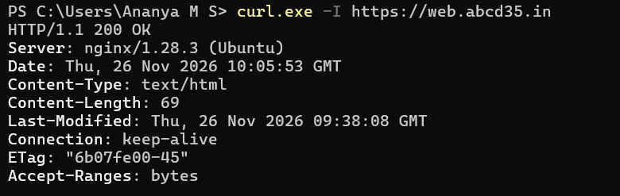

# Introduction to Web Hosting

## Aim
To understand how a website is stored on a server and delivered to a visitor, and to host a simple website on AWS with my own domain.

## What I did
1. Launched an Ubuntu EC2 server on AWS and allowed ports 22 (SSH), 80 (HTTP) and 443 (HTTPS) in the security group.
2. Installed Nginx, the web server, and created a simple home page.
3. Added an A record in Route 53 so that `web.abcd35.in` points to the server.
4. Tested the site with `nslookup`, `ping` and `curl`.
5. Enabled HTTPS with a free Let's Encrypt certificate using Certbot.

## Key terms
- **Web server (Nginx):** the program that sends the website files to visitors.
- **DNS:** the phone book of the internet. It turns a domain name into an IP address.
- **A record:** a DNS entry that points a name to an IP address.
- **Ports 80 and 443:** the doors for HTTP and HTTPS.

## Screenshots

### 1. Website in the browser

### 2. DNS lookup, ping and curl

Ping times out because AWS blocks ICMP by default. The site still responds normally, as the curl result shows.

### 3. Nginx running

### 4. Route 53 DNS record

### 5. HTTPS working

## What I learned
- How a domain name reaches a server through DNS
- How a security group works as a firewall
- How to run a web server and enable HTTPS on Ubuntu
